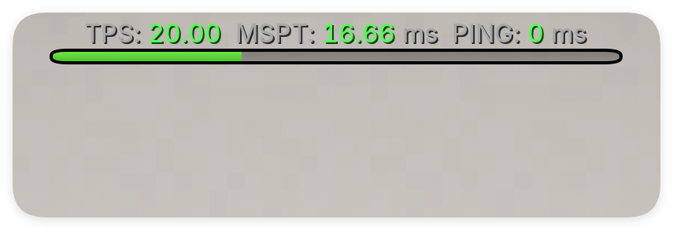

# TPSBar

[简体中文](README.md) | [English](README.en.md)

TPSBar is a Rust/WASM plugin for Pumpkin servers. Each player can independently toggle their performance BossBar with `/tpsbar`. Their choice is stored in the plugin's private data directory and persists across reconnects and server restarts.



This is a third-party Pumpkin plugin supervised by PING, who designs its features and manages its releases; **its code is generated by an LLM**. It is not affiliated with, sponsored by, or endorsed by the PumpkinMC organization.

```text
TPS: 20.00  MSPT: 19.24 ms  PING: 8 ms
```

The interface layout is inspired by the familiar TPSBar design in Purpur.

## Features

- Disabled by default and only shown to players who explicitly run `/tpsbar`.
- Independent BossBar, ping value, and persistent preference for every player.
- Reads TPS, MSPT, and ping through official Pumpkin APIs without modifying the world or game logic.
- Fills the BossBar by MSPT by default: `50 MSPT` fills the bar; switch the metric in config or with `/tpsbar by mspt|tps|ping`.
- Color-coded TPS, MSPT, and ping values, with light-gray labels and units.
- Refreshes every 20 ticks by default, using one server sample for all enabled players.
- Available to Pumpkin permission level 3 (administrator) and above by default.
- Built-in Simplified Chinese and English messages selected from each client's locale, with a configurable fallback locale.
- Removes only BossBars owned by this plugin when a player disconnects, loses permission, or the plugin unloads.

## Permission

| Node | Default | Purpose |
| --- | --- | --- |
| `tpsbar:command.toggle` | `op level 3` | Toggle the sender's own TPSBar |

Pumpkin v0.2's permission WIT defines a node as a full name (for example, `minecraft:command.gamemode`). The host registers the supplied string as-is. TPSBar registers `tpsbar:command.toggle` in the `plugin-namespace:node` form, rather than Bukkit/Paper's dot-separated form. The default operator level can be set from `0` to `4`; level `0` makes it available to regular players by default.

## Configuration and data

On first load, TPSBar creates `config.toml` inside the private data directory assigned by Pumpkin. See [`assets/config.default.toml`](assets/config.default.toml) for all default values.

Default MSPT color ranges:

- `[0, 35)`: green
- `[35, 50)`: yellow
- `[50, 80)`: gold
- `[80, +∞)`: red

BossBar progress defaults:

- `bar.metric = "mspt"`: fills at `bar.mspt_full` (50 by default).
- `bar.metric = "tps"`: uses the configured target TPS (20 by default) as full.
- `bar.metric = "ping"`: fills at `bar.ping_full` (200 by default).

Administrators can switch the live metric with `/tpsbar by mspt`, `/tpsbar by tps`, or `/tpsbar by ping`. The command changes the current server instance; after a restart, the plugin config is used again.

The state file is versioned JSON. Saves use a temporary file and backup recovery flow so an interrupted write does not directly corrupt the existing preferences.

## I18N strategy

TPSBar selects messages from each player's client-reported locale instead of forcing one server-wide language through configuration. Version 0.2.0 includes `zh_cn` and `en_us`; `fallback_locale` is used only when the client language is unsupported.

TPSBar selects Simplified Chinese or English messages from each player's client-reported locale. For other languages, it uses the configured `fallback_locale`.

## Building

Rust 1.96 or later and the `wasm32-wasip2` target are required. `rust-toolchain.toml` pins the verified Rust 1.97.1 toolchain:

The Plugin API is pinned to the Pumpkin `0.2.1` tag at commit `224f9f8144ca53a8d0800acb87607d714196e2a6`, so local and CI builds use the same upstream source.

```powershell
rustup target add wasm32-wasip2
cargo +1.97.1 fmt --check
cargo +1.97.1 test --target x86_64-pc-windows-msvc
cargo +1.97.1 clippy --target x86_64-pc-windows-msvc --all-targets -- -D warnings
cargo +1.97.1 build --release
```

`.cargo/config.toml` sets `wasm32-wasip2` as the default target. `build/version.txt` is the single release-line source and currently contains `0.2`; Cargo metadata stays at `0.2.0`. Cargo's raw output is written to `target/wasm32-wasip2/release/tpsbar.wasm`.

For a local development snapshot, run `.\build\build.ps1`; it writes `tpsbar-0.2.0-dev.<12-digit timestamp>+0.2.1.wasm` to `publish/`. For a release, run `.\build\build.ps1 -Release -OutputDirectory ..\..\OUTPUT\tpsbar` to create `tpsbar-v0.2+0.2.1.wasm`. GitHub Actions calls the same build script: non-tag builds use timestamped snapshots, while a matching `v0.2+0.2.1` tag uses the release version. The ZIP distribution includes the same WASM, the project license, and third-party licenses.

GitHub Actions runs formatting, tests, Clippy, and a WASM release build on pushes, pull requests, and manual dispatches, then uploads the WASM artifact for download.

### Pumpkin compatibility

Cross-platform support through [PumpkinMC](https://pumpkinmc.org/). Supported Pumpkin version: `0.2.1`.

## Installation

Open a terminal in the directory containing the Pumpkin executable and install with PPM:

```powershell
ppm install 0Y9WQt4l
```

Alternatively, place `tpsbar-v0.2+0.2.1.wasm` from the Release in Pumpkin's plugin directory and start the server. On first load, Pumpkin asks for the plugin's two private data-directory permissions. TPSBar requests only:

- `fs.read.data`
- `fs.write.data`

It does not request network access, system information, or filesystem access outside its private data directory.

## Compatibility

- Java clients: support segmented rich-text colors in the title.
- Bedrock clients: Pumpkin currently converts BossBar titles to plain text. Values and the BossBar color remain visible, but per-segment title colors may be lost.
- TPS is capped at the configured target value, avoiding values above 20 from the raw official `1000 / MSPT` calculation when MSPT is very low.

## License

Copyright 2025-2026 PING

Licensed under the [Apache License 2.0](LICENSE). See [THIRD-PARTY-NOTICES.md](THIRD-PARTY-NOTICES.md) for the dependency summary and `LICENSES/` for archived license texts. After updating the lockfile, run:

```powershell
./scripts/update-licenses.ps1
```
